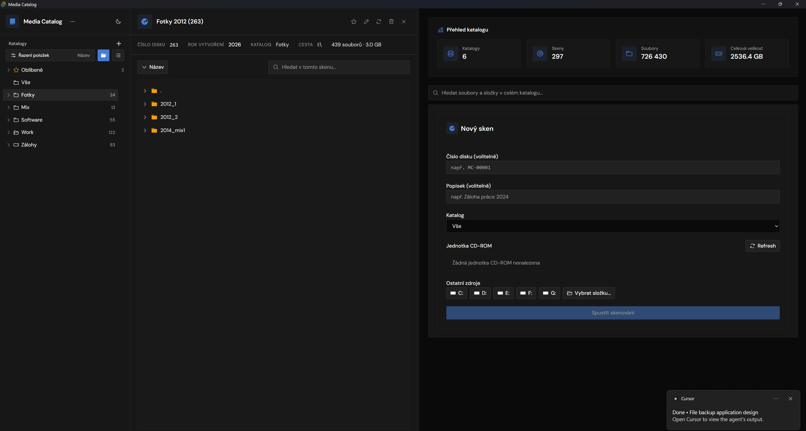

# Media Catalog



Offline desktopová aplikace pro indexaci fyzických médií (CD, DVD) a složek. Naskenuje strukturu souborů a pak v ní jde hledat, aniž by médium bylo v mechanice.

## Funkce

- Sken disku nebo složky do lokálního katalogu
- Strom katalogů, oblíbené položky, přesun skenů
- Detail skenu se stromem souborů
- Fulltext přes názvy souborů a složek v celém katalogu
- Import a export databáze (import přepisuje katalog a chce potvrzení)
- Funguje offline

## Stack

- Tauri 2, React 19, Vite, TypeScript
- Tailwind v4, shadcn/ui, Phosphor Icons
- SQLite přes rusqlite

## Požadavky

- Node.js 18+
- [Rust](https://www.rust-lang.org/tools/install)
- [Tauri prerequisites](https://tauri.app/start/prerequisites/)
- Na Windows: Visual Studio Build Tools (Desktop development with C++)

## Vývoj

```bash
npm install
npm run tauri:dev
```

`npm run dev` spustí jen frontend. Příkazy do databáze v něm nefungují.

## Sestavení

```bash
npm run tauri:build
```

Výstup je `src-tauri/target/release/media-catalog.exe`.

Sestavení jen přes `cargo build --release` nepoužívej. Takový binár hledá frontend na `localhost:1420` a v produkci se nespustí.

## Databáze

Aplikace si katalog ukládá lokálně do `CDMediacatalog/media_catalog.db` vedle projektu. Tahle složka je v `.gitignore` a do repozitáře nepatří. Po naklonování vznikne prázdný katalog prvním spuštěním.
